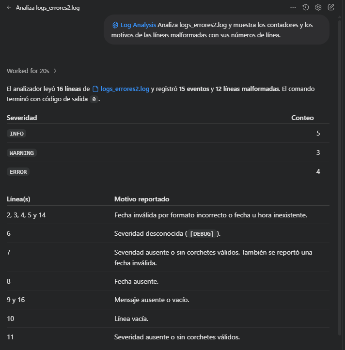
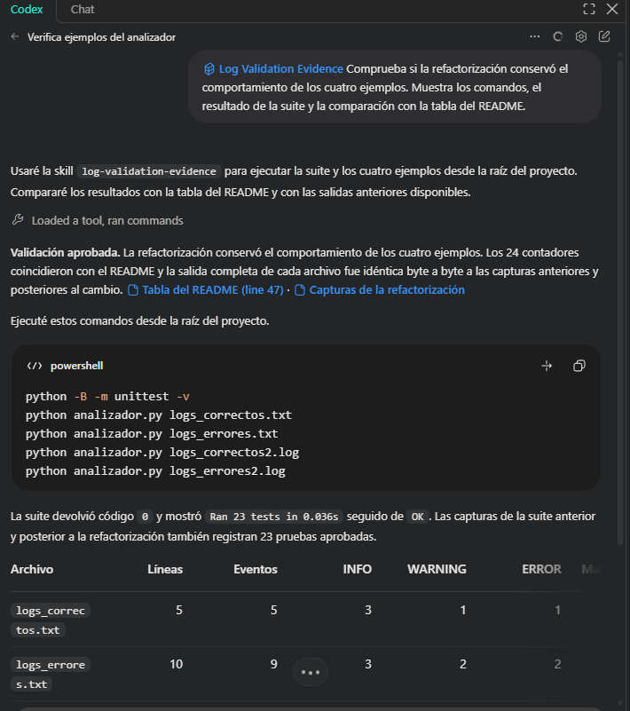
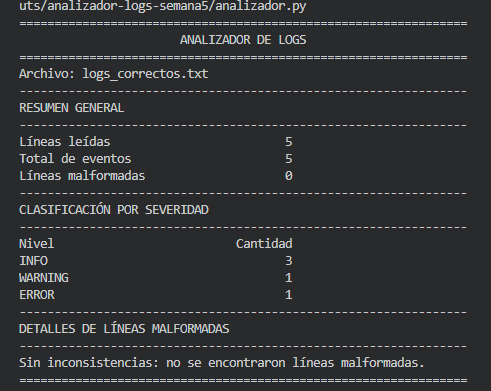
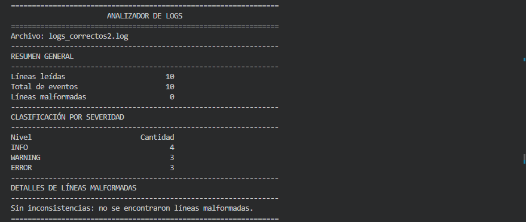
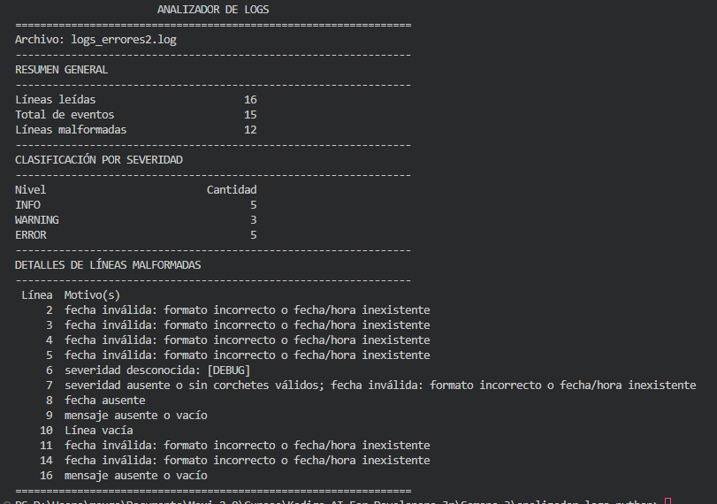
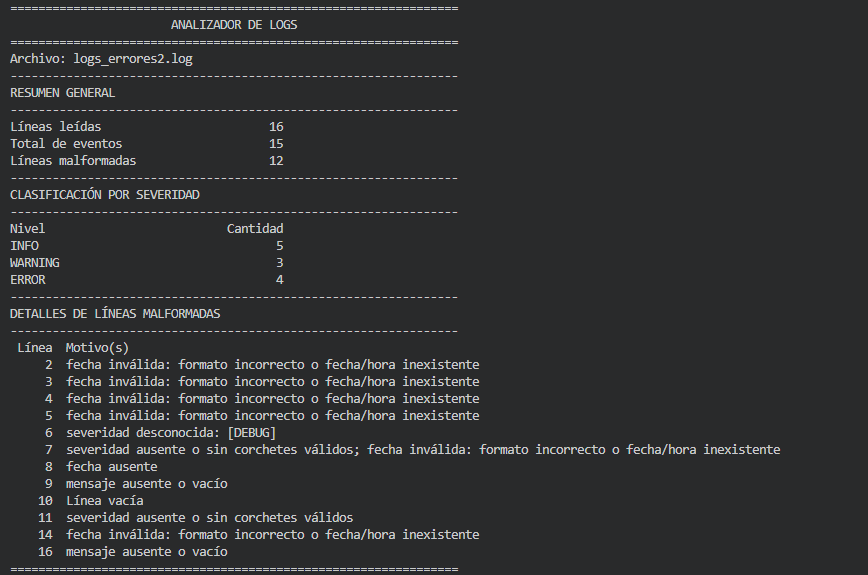

# Refactorización y personalización del analizador de logs

**Semana 5  Actividad individual**  
**Alumno:** Max Gabriel Sánchez Flores  
**Coach:** Ronald Mejía

## Descripción del proyecto

El proyecto de Semana 3 era un analizador tradicional en Python que desarrollé con apoyo de IA. Lee registros de texto UTF-8, reconoce los niveles `INFO`, `WARNING` y `ERROR`, comprueba las fechas e informa en consola los conteos y los motivos de las líneas malformadas. Los cuatro ejemplos usan registros ficticios de autenticación y funcionamiento de servicios.

En Semana 5, Codex es el entorno en el que se ejecuta el agente `log-reviewer`. El agente interpreta la petición, lee las instrucciones de la skill que corresponde y ejecuta los comandos. Python sigue leyendo los archivos, aplicando las reglas y calculando los resultados. El analizador se puede usar directamente desde la terminal.

## Uso de IA y responsabilidades

Decidí conservar el analizador de logs que funcionó correctamente en la Semana 3 y trabajar en un repositorio separado. Le pedí a Codex que guardara el resultado de las pruebas antes de editar y que detuviera el cambio si alguna fallaba. También pedí conservar las pruebas, los cuatro archivos de ejemplo y el comportamiento anterior porque ya tenía una referencia para revisar el resultado.

En Semana 3, Codex interpretó al principio que la fecha iba antes de la severidad. Mis archivos empezaban con la severidad entre corchetes y luego llevaban la fecha. Le pedí que ajustara el programa al orden de los ejemplos. Esa corrección explica por qué en Semana 5 se mantienen los archivos de entrada y se compara lo que el programa imprimía al procesarlos.

Decidí guardar las dos skills dentro del proyecto para que se pudiera utilizar las skills con la misma configuración dentro de la carpeta en la que trabajé, pero luego se pueden migrar a la carpeta .agents o .codex para ser utilizadas globalmente. Fijé un límite de menos de 400 palabras para cada una, incluido el encabezado. Codex redactó las instrucciones, configuró `log-reviewer` y separó la lógica del programa en otro módulo. Le pedí que la solicitud diera al agente suficiente información para escoger una skill sin que yo tuviera que nombrarla.

Para revisar el trabajo le pedí a Codex dos evidencias. La primera fue la ejecución de las pruebas y la comparación de los cuatro ejemplos con las salidas anteriores. La segunda fue la lectura del archivo de instrucciones seguida de los comandos que ejecutó el agente. En la primera sesión del agente, seis pruebas dieron error al crear sus archivos temporales. Codex repitió la validación con permiso de escritura limitado al espacio de trabajo y registró los dos resultados.

## Cómo quedó repartido el código

Antes, `analizador.py` reunía los argumentos de consola, el selector gráfico, la lectura del archivo, las reglas para detectar registros malformados, los contadores y la presentación. La refactorización dejó en ese archivo la entrada por consola, el selector, el manejo de errores y el resumen. `logica_analisis.py` contiene la validación, el análisis por línea y la lectura y agregación del archivo. El módulo de consola importa las funciones de análisis para mantener los nombres que usan las pruebas. [Entrada y presentación](analizador.py) · [Lógica de análisis](logica_analisis.py) · [Diff de la refactorización](verificacion-semana5/refactor.diff).

Conservé `python analizador.py <ruta>` porque es la forma en que ya probaba los ejemplos y es la que puede ejecutar el agente sin abrir una ventana. Cuando se omite la ruta, el programa intenta mostrar el selector para archivos `.txt` y `.log`, con una opción para ver todos los archivos. Si falta `tkinter` o no hay un entorno gráfico disponible, pide la ruta por consola.

## Reglas de validación

1. El registro empieza con `[INFO]`, `[WARNING]` o `[ERROR]`. Se permiten espacios antes de la etiqueta.
2. La fecha usa el formato `AAAA-MM-DD` o `AAAA-MM-DD HH:MM:SS` y debe existir en el calendario. La hora, si aparece, debe ser válida.
3. Una severidad reconocida se cuenta aunque haya un problema con la fecha o el mensaje. La línea también se reporta como malformada.
4. Una línea vacía se cuenta como malformada. El total de eventos corresponde a las líneas que contienen texto.
5. Una severidad desconocida como `[DEBUG]` se reporta. Los contadores de las tres severidades admitidas se conservan.
6. Una línea con varios problemas se cuenta una sola vez como malformada y se muestran todos sus motivos.
7. Un mensaje ausente o vacío se reporta como inconsistencia. El programa deja tal como están los datos del archivo.

## Skills y agente personalizado

`log-analysis` recibe la ruta de un log. Si falta la ruta, la pide. Ejecuta el analizador y entrega las líneas leídas, el total de eventos, los conteos por severidad y los motivos de las inconsistencias con sus números de línea. Si el comando falla, informa el mensaje y el código de salida. [Instrucciones de log-analysis](.agents/skills/log-analysis/SKILL.md).

`log-validation-evidence` se usa para comprobar si un cambio afectó el comportamiento. Ejecuta la suite y los cuatro ejemplos, coteja los totales con la tabla del README y registra los comandos, los códigos de salida y las diferencias. Cuando hay salidas anteriores, las compara con la ejecución actual. [Instrucciones de log-validation-evidence](.agents/skills/log-validation-evidence/SKILL.md).

`log-reviewer` aplica `log-analysis` cuando le piden analizar un archivo y `log-validation-evidence` cuando le piden comprobar un cambio. Si la solicitud incluye ambas tareas, lee y aplica las dos. Su configuración le indica que registre el archivo de instrucciones que leyó y que fundamente su respuesta en lo que devuelvan los comandos. El rol se limita a leer y ejecutar comprobaciones. El modelo lo resuelve la sesión de Codex. Para la temperatura mencionada en la diapositiva, el esquema de agentes personalizados del cliente no expone un campo `temperature`. [Configuración de log-reviewer](.codex/agents/log-reviewer.toml) · [Campos admitidos por Codex](https://learn.chatgpt.com/docs/agent-configuration/subagents#custom-agent-file-schema).

## Resultados esperados

| Archivo | Líneas | Eventos | INFO | WARNING | ERROR | Malformadas |
| --- | ---: | ---: | ---: | ---: | ---: | ---: |
| [`logs_correctos.txt`](logs_correctos.txt) | 5 | 5 | 3 | 1 | 1 | 0 |
| [`logs_errores.txt`](logs_errores.txt) | 10 | 9 | 3 | 2 | 2 | 7 |
| [`logs_correctos2.log`](logs_correctos2.log) | 10 | 10 | 4 | 3 | 3 | 0 |
| [`logs_errores2.log`](logs_errores2.log) | 16 | 15 | 5 | 3 | 4 | 12 |

### Evidencia de las pruebas en VS Code

**Invocación explícita de `log-analysis`.** El análisis de `logs_errores2.log` mostró 16 líneas, 15 eventos, 4 entradas `ERROR` y 12 líneas malformadas.

**Invocación explícita de `log-validation-evidence`.** La vista de Codex muestra los comandos de la suite y de los cuatro ejemplos. La suite reportó 23 pruebas y `OK`.

**Salida de consola de la prueba manual.** El resumen de `logs_correctos.txt` mostró 5 líneas, 5 eventos y 0 líneas malformadas. La captura muestra el resultado en la consola.

## Cómo probar las skills

1. Abrir en VS Code la carpeta raíz `analizador-logs-semana5`, donde está este README. Compruebar que la carpeta incluye `.agents/skills/` y `.codex/agents/`. Para el analizador se recomienda Python 3.12 en el PATH. Usar la biblioteca estándar y el selector opcional requiere `tkinter` y un entorno gráfico. Para probar el agente, hace falta la extensión Codex para VS Code y una sesión iniciada en ella. Se puede realizar la prueba de la skill con otro agente, sin embargo ha sido creada inicialmente y probada en Codex en VSCode.

2. Abrir una terminal integrada en la raíz del proyecto. En Windows, ejecutar estos comandos si `python` es el nombre disponible.

   ~~~powershell
   python --version
   python analizador.py logs_correctos.txt
   python analizador.py logs_errores.txt
   python analizador.py logs_correctos2.log
   python analizador.py logs_errores2.log
   python -B -m unittest -v
   ~~~

   Si el sistema usa `python3`, como suele ocurrir en Linux y macOS, ejecute estos comandos.

   ~~~bash
   python3 --version
   python3 analizador.py logs_correctos.txt
   python3 analizador.py logs_errores.txt
   python3 analizador.py logs_correctos2.log
   python3 analizador.py logs_errores2.log
   python3 -B -m unittest -v
   ~~~

   Los cuatro resúmenes deben coincidir con la tabla y la suite debe mostrar `Ran 23 tests` y `OK`. Para probar el selector gráfico, ejecutar `python analizador.py` o `python3 analizador.py` sin argumentos. Seleccionar un ejemplo y revisar su resumen. También se puede abrir el selector de nuevo y cancelar para comprobar el mensaje de cancelación.

3. Abrir el panel lateral de Codex e iniciar un chat nuevo desde esa carpeta. En la paleta de comandos de VS Code, la extensión instalada para esta entrega ofrece **Open Codex Sidebar** y **New Chat in ChatGPT Sidebar**. Para ejecutar la suite desde Codex, usa un modo de permisos que permita crear directorios temporales de prueba. Si su terminal solo tiene `python3`, añadir esta frase a los prompts que se usarán en Codex: `Usa python3 como intérprete en los comandos.`

4. Probar las skills por separado y de forma explícita. Usar una solicitud por skill. Si el editor muestra un menú de skills al escribir `$`, seleccionar la que aparece al principio de cada prompt.

   ~~~text
   $log-analysis Analiza logs_errores2.log y muestra los contadores y los motivos de las líneas malformadas con sus números de línea.
   ~~~

   Debe obtener **16 líneas, 15 eventos, 4 entradas ERROR y 12 líneas malformadas**, con los motivos numerados. La línea 11 debe aparecer con un problema de severidad.

   ~~~text
   $log-validation-evidence Comprueba si la refactorización conservó el comportamiento de los cuatro ejemplos. Muestra los comandos, el resultado de la suite y la comparación con la tabla del README.
   ~~~

   Debe obtener las **23 pruebas aprobadas** y una comparación de los cuatro archivos con la tabla. Los cuatro ejemplos deben devolver código de salida `0`.

5. Iniciar otra sesión nueva y probar la decisión de `log-reviewer`. Enviar la primera petición, esperar su resultado y luego enviar la segunda.

   ~~~text
   Delega en el agente personalizado log-reviewer únicamente este mensaje: «Analiza logs_errores2.log.» Espera su informe.
   ~~~

   Debe observar que el agente usa `log-analysis` y obtiene los resultados del primer caso.

   ~~~text
   Envía al mismo log-reviewer únicamente este mensaje: «Comprueba si la refactorización conservó el comportamiento de los cuatro ejemplos.» Espera su informe.
   ~~~

   Debe observar que el agente usa `log-validation-evidence`, ejecuta la suite y compara los cuatro ejemplos.

6. Abrir el detalle de la ejecución de Codex. En las pruebas con `log-reviewer`, revisar el detalle del subagente. Buscar un registro de carga de la skill o una lectura de su `SKILL.md` antes de los comandos de Python. En las trazas de la entrega, esa lectura aparece como `Get-Content`. Los conteos permiten verificar el programa.

## Evidencia de refactorización

### Semana 3. Un ERROR dentro del mensaje

En Semana 3, `logs_errores2.log` llegó a mostrar cinco entradas `ERROR`. La línea 11 contenía `[ERROR]` dentro del mensaje y el programa usaba `search()`, que buscaba en toda la línea. Codex cambió la búsqueda por `match()` sobre el texto sin espacios exteriores para reconocer la etiqueta al inicio. El contador bajó de cinco a cuatro y el archivo siguió reportando 12 líneas malformadas. El caso ahora sirve como prueba de regresión en `test_etiquetas_en_mensaje_no_son_severidad`. [Prueba de regresión](test_analizador.py#L15).

**Ejemplo adicional con registros válidos**

**Cinco entradas ERROR antes de la corrección de Semana 3**

**Cuatro entradas ERROR después de la corrección de Semana 3**

### Semana 5. Refactorización y ejecución directa

La corrida previa a la refactorización registró **23 pruebas aprobadas**. Al repetir la suite tras mover la lógica, pasaron las mismas 23. Los cuatro ejemplos conservaron la salida de consola byte a byte, devolvieron código `0` y dejaron `stderr` vacío. [Suite antes del cambio](verificacion-semana5/unittest-antes.txt) · [Suite después del cambio](verificacion-semana5/unittest-despues.txt) · [Comparación de consola](verificacion-semana5/comparacion.md).

En una ejecución directa de la entrega, Codex repitió la suite y los cuatro comandos desde la raíz. Pasaron las 23 pruebas y los cuatro resúmenes coincidieron con la tabla y con las capturas de la refactorización. Los casos de selector de la suite usan simulaciones. La comprobación gráfica en una ventana real sigue pendiente. [Suite de la entrega](verificacion-semana5/entrega/unittest.txt) · [Comandos y salidas](verificacion-semana5/entrega/validacion.md).

### Semana 5. Demostración con el agente

En sesiones nuevas del cliente de Codex, las peticiones visibles nombraron al agente y describieron la tarea. En el primer caso, la traza registra la lectura de `log-analysis/SKILL.md` y el comando para `logs_errores2.log`, que devolvió los totales esperados. En el segundo, la traza registra la lectura de `log-validation-evidence/SKILL.md` y la comparación de los cuatro ejemplos. En modo de solo lectura, seis pruebas dieron error por falta de un directorio temporal utilizable. El reintento en modo de escritura limitada al espacio de trabajo aprobó las 23 pruebas y comprobó la igualdad de las salidas con las capturas anteriores. [Análisis y validación en orden](verificacion-semana5/entrega/log-reviewer-demostracion.jsonl) · [Reintento de validación](verificacion-semana5/entrega/log-reviewer-validacion.jsonl) · [Informe de la demostración](verificacion-semana5/entrega/demostracion.md).

Las peticiones visibles de esa demostración se enviaron sin invocar las skills con `$`. El cliente de la demostración no mostró el texto interno reenviado al subagente. La traza permite comprobar la lectura de las instrucciones y su ejecución. La prueba explícita con `$` en VS Code queda para la reproducción en el PC del coach.

## Reflexión técnica

Cuando pedí separar los archivos, me interesaba que cambiar la presentación del resumen no obligara a revisar las reglas de fecha o el conteo de severidad en el mismo bloque. Por eso conservé el comando que ya usaba con los cuatro ejemplos. Pude pedir la misma prueba antes y después del cambio y revisar si el texto que recibe quien usa el programa seguía siendo el mismo.

La separación también me ayuda a explicar qué parte depende de la IA. Si le pido a `log-reviewer` que revise un archivo, espero que me diga qué encontró en ese archivo. Si le pido que compruebe una modificación, quiero ver la suite y los cuatro resultados. Para revisar cuál de las dos tareas siguió, necesito ver qué instrucciones leyó y qué ejecutó. Un conteo correcto por sí solo me sirve para revisar Python.

El intento de solo lectura me dejó otro punto para revisar. La suite sí se inició y seis pruebas dieron error al intentar crear sus archivos temporales. El reintento pasó con las mismas pruebas y los mismos logs. Para el selector, me queda la comprobación en una ventana real. La prueba simulada me permite revisar qué hace el programa cuando se cancela o cuando falta `tkinter`.